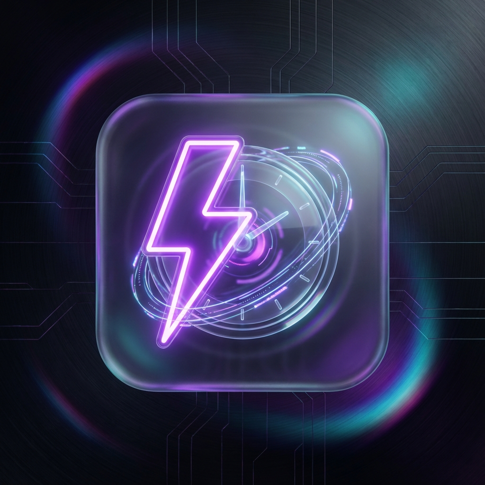

# ⚡ VirajVerse: Daily Routine AI Assistant ⚡

<p align="center">
  
</p>

<p align="center">
  <b>Next-Gen Personal Productivity powered by Llama 3.3 & Piper TTS.</b><br>
  <i>Not just an app, but a biological clock synchronization engine.</i>
</p>

<p align="center">
  
  
  
  
</p>

---

## 🚀 The Vision
Traditional routine apps are boring lists. **Daily Routine AI** is an experience. It's designed for those who want to live in the future—where your AI friend doesn't just list tasks but speaks to you, motivates you, and tracks your biological consistency with clinical precision.

## 💎 Elite Features

- **🧠 Neural Routine Generation**: Uses Groq-powered `llama-3.3-70b-versatile` to transform your messy Hinglish/Hindi notes into a perfectly structured daily architecture.
- **🎙️ Piper Local Voice Integration**: Ultra-low latency Hindi female voice (`hi_IN-reena-medium`) that talks to you like a real human, not a robot.
- **✨ Next-Level Glassmorphism**: High-performance UI with frosted glass effects, neon glows, and 60fps micro-animations.
- **📊 Consistency Stream**: Advanced logic charts using Chart.js to visualize your efficiency over time.
- **📱 True PWA Experience**: One-tap installation on Android/iOS. Works offline using LocalStorage for extreme speed and privacy.
- **🔔 Proactive Reminders**: Sends notification and voice alerts 5 minutes before every task.

## 🛠️ Tech Stack: The Future Foundation

| Layer | Technology |
| :--- | :--- |
| **Frontend** | React 18 + Vite |
| **Logic** | TypeScript (Strict Mode) |
| **AI Gateway** | Groq API (Llama 3.3) |
| **Voice Engine** | Piper TTS (Local Server) + Browser SpeechSynthesis |
| **Styling** | Tailwind CSS + Framer Motion |
| **Persistence** | Secure LocalStorage API |

---

## ⚙️ Installation (The Developer Way)

```bash
# 1. Clone the future
git clone https://github.com/virajverse/dailytoutineapp.git

# 2. Enter the matrix
cd dailytoutineapp

# 3. Inject dependencies
npm install

# 4. Set your pulse (API Key)
# Create a .env file and add:
VITE_GROQ_API_KEY=your_groq_api_key_here

# 5. Launch
npm run dev
```

---

## 📱 Termux Setup (Carry it in your pocket)

Running this on Android is a flex. Here is how:

```bash
pkg update && pkg install nodejs git
git clone https://github.com/virajverse/dailytoutineapp.git
cd dailytoutineapp
npm install
# Setup .env as shown above
npm run dev
```
*Open `http://localhost:8080` in your Chrome browser and click **Install Mobile App**.*

---

## 📂 Architecture Overview

```text
src/
├── components/          # Premium UI components (Glassmorphism layers)
├── hooks/               # Custom hooks (Voice, Routine, Notification logic)
├── lib/                 # Utility functions (Tailwind merging)
├── pages/               # Main Page & 404 (Minimalist Router)
└── types/               # Strict TS interfaces for Routine data
```

## 🤝 Contribution
The VirajVerse is open for enhancement. Feel free to fork, add 3D elements, or integrate even more LLMs.

---

<p align="center">
  Built with ❤️ for the elite 1% who prioritize discipline.
</p>
